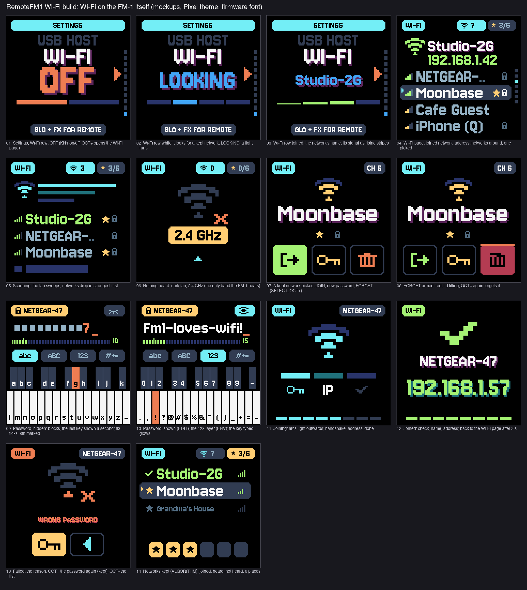

# Wi-Fi on the FM-1 itself (mockups)

The Wi-Fi build's standalone: HOME held (or GLO + HOME) opens the settings, the new **WI-FI** row opens the Wi-Fi
pages, where you can browse, join and forget networks and type a password on the keys (Elasticat's keybed). These are
mockups only. Nothing in the firmware has changed.

Each PNG is 240 x 240 and is drawn by `make_wifi_mockups.py` with the firmware's own primitives (`sg_rect`, `sg_chip`,
`sg_text`, `sg_text_sh`, `sg_chip_text`, `sg_sprite`), its Jersey 10 grid font (`firmware/build/gen/sa_font.h`) and
the Pixel theme through RGB565. `fm1gfx.py` is the host copy of `sa_gfx.c`. It draws today's USB HOST settings row
pixel-for-pixel the same as the Wi-Fi simulator's shot (`python3 fm1gfx.py <shot.png>` prints 0 differing pixels).
Regenerate with `python3 design/wifi-settings/make_wifi_mockups.py`.

## Controls (one rule set for all the pages)

- **SELECT** moves the pick (a row or a tile). **OCT+** opens or does it. **OCT-** goes back one level (in the
  password it deletes). **HOME** closes the settings, as it does today (in the password it cancels, as in Elasticat).
- Everything is a single click. No holds were added (HOME held to open the settings is the owner's own).
- OCT+ / OCT- light while they do something (fm1-base's LED glow), so the page shows its way in and out without text.

| # | Screen | Controls | Motion |
|---|---|---|---|
| 01-03 | **Settings, WI-FI row** (11th, after USB HOST; colour A5 in the row cycle). Value: `OFF`, `LOOKING` (states 1-4), or the joined name; `NOT FOUND` / `COULD NOT JOIN` for state 6 | SELECT the row (as now), **KN1 Wi-Fi off/on** (like USB HOST), **OCT+ opens the Wi-Fi page** (the orange arrow) | LOOKING: a light runs along 4 stripes (150 ms a step). Joined: the stripes become the signal, rising. The arrow nudges right once a second |
| 04 | **Wi-Fi page**: the joined network on top (fan lit to its signal, name, address), then the networks around: bars, name, a star if kept, a lock if secured. Header: two tabs, around (count) and kept (n/6) | SELECT picks; the top card is pick 0. **ALGORITHM switches between around and kept** (14). OCT+ opens the pick (07, or 09 for a new secured one; an open one joins at once). OCT- back to settings | A long name scrolls while picked (250 ms a character). Dots on the right show the place in the list (up to 12) |
| 05 | **Scanning** (on opening the page, unless joining) | **SELECT turned up past the top scans again** (a "pull to refresh") | The fan's arcs light outwards in turn; sweep bars; networks drop in, strongest first; a dim placeholder row breathes |
| 06 | **Nothing heard**: dark fan, orange cross, `2.4 GHz` chip (the radio's only band: a 5 GHz router or a phone hotspot without "Maximise Compatibility" will not show) | SELECT up: scan again | The up arrow nudges |
| 07 | **A network picked** (kept): fan in its signal colour, name big, star and lock; channel chip. Three tiles: JOIN, a new password, FORGET | SELECT the tile, OCT+ does it, OCT- back | The picked tile fills with its colour |
| 08 | **FORGET armed** | OCT+ again forgets (FORGET k); anything else disarms | Tile red, lid lifts and shakes; disarms by itself after 3 s |
| 09-10 | **Password**: chip with lock and SSID; eye chip; the field; 63 length ticks (the 8th taller, orange under 8, green from 8) and the count; layer chips; the keybed (11 black over 16 white, as the keys lie) | **Keys type** the character on them. **FX / SEL / ENV / LFO pick the layer** abc / ABC / 123 / #+= (their LEDs show it); **GLO held: ABC for the next key** (Elasticat's SHIFT). **EDIT shows or hides.** ALGORITHM moves the cursor; SELECT / KN1 change the character under it (all 95). OCT- deletes (empty: back), GLO + OCT- clears. **OCT+ joins**, lit only at 0 or 8..63 characters | The key typed glows orange 250 ms (its LED too). Hidden: the last character shows 1 s, then becomes a block. The cursor blinks every 500 ms. The window scrolls with a dim `<` |
| 11 | **Joining**: the fan, three steps (key: handshake, state 3; IP: address, state 4; check: done), the time bar | OCT- cancels (back to the list; the networks kept are tried again) | Arcs light from the dot outwards (150 ms an arc); the step under way breathes; the bottom blocks fill over the 15 s timeout |
| 12 | **Joined**: check, name, address | Any control, or 2 s: back to the Wi-Fi page | The check drops in and bounces once |
| 13 | **Failed**: dark fan, cross, the reason (`WRONG PASSWORD`, `NOT FOUND`, `NO ADDRESS`) | **OCT+ goes back to the password** (kept as typed, cursor at the end); OCT- goes to the list | The cross shakes once |
| 14 | **Networks kept** (ALGORITHM): a check for the joined one, stars, names (dim when not heard in the last scan, with empty bars), signal; six places along the bottom | SELECT picks, OCT+ opens it (07: join / password / forget) | The new network's star drops into its place after a join |

### The keybed's layers (every printable ASCII character)

| layer (button) | black keys B1..B11 | white keys W1..W16 |
|---|---|---|
| abc (FX) | `a`..`k` | `l`..`z`, space |
| ABC (SEL, or GLO held) | `A`..`K` | `L`..`Z`, space |
| 123 (ENV) | `0`..`9`, `-` | `. , ! ? @ # $ % & * ( ) _ + =`, space |
| #+= (LFO) | `0`..`9`, `-` | `' " / \ : ; < > [ ] { } \| ^ `` ` `` ~` |

This is Elasticat's keybed (`src/app/ec_e5.c` naming: letters on B1..B11 then W1..W16, SPACE as a bar, SHIFT for the
second set, ALGO the cursor, SEL / K1 the character, OCT- delete, OCT+ OK, HOME cancel), extended from 2 sets to 4 so
that a password can use any printable character. Lower case comes first because most passwords are lower case.

## The budget (Wi-Fi build: ~2.7 KB of RAM left, flash ~28 KB left)

- **No new drawing code or font.** Every screen uses only `sa_gfx.c`'s calls and the Jersey 10 font, at scales 1-6.
  The icons (fan, lock, star, check, cross, eye, key, trash, join) are `sg_sprite` strings of 5-13 x 5-11: about
  0.5 KB of flash in all. Screens are painted in bands as now, so there is no frame buffer.
- **No copy of the lists.** The scan list (12 networks) and the kept list (6) are fm1-base's (`plat_wifi_found`,
  `plat_wifi_saved`). The painter reads the 4-5 visible rows from them for each band. The UI snapshot keeps only the
  pick, the first visible row, the tab and the counts (about 8 bytes).
- **The password** is a 64-byte buffer, plus cursor, layer and flags (about 70 bytes). It is zeroed when the page
  closes and is never logged, which follows PROTOCOL.md section 10.
- In all: **under 100 bytes of RAM** and about 3-4 KB of flash for the pages' code and strings (`tools/wifi_layout.py`
  must still pass).
- Joining goes through `plat_wifi_join(ssid, pass)`, or `pass` 0 for a kept network. Forgetting uses
  `plat_wifi_forget(k)`; scanning uses `plat_wifi_scan` / `plat_wifi_scans`. A scan stops a join, so the page never
  scans by itself while the state is 3 or 4.

## Open questions for the owner

1. **"Wrong password" is a guess.** fm1-base reports only `could not join` (association failed or timed out:
   `base/device/wifi.c`), the same as when the network goes away. The mockup says WRONG PASSWORD when a password was
   just typed and the network was heard in the last scan, and COULD NOT JOIN otherwise. Is that acceptable, or should
   fm1-base be patched to separate the handshake failure?
2. **Turning Wi-Fi on freezes the panel for up to 15 s** while the radio calibrates (fm1-base masks the input timer
   and the sound). KN1 OFF to ON on the WI-FI row would show a still "starting" fan and then come back. Do you want
   that, or should Wi-Fi always be on in this build, with the row just opening the page?
3. **Control mapping.** OCT+ in / OCT- back / HOME out everywhere, the password layers on FX / SEL / ENV / LFO, and
   EDIT to show or hide. The alternative is Elasticat's exact set (SHIFT held for the second set only, with symbols
   reached by SELECT / KN1 turning). Also: should the keybed's characters on the keys stay at scale 1 (10 px capitals,
   as Elasticat's), which is under the ~12 px rule, given that the typed character also shows at scale 2 in the field?

## The owner's decisions (2026-11-19)
1. Failed join wording: best guess (WRONG PASSWORD when a password was just typed and the network was heard in the last scan, else COULD NOT JOIN); no fm1-base patch.
2. Keep the KN1 on/off toggle on the WI-FI row (the up-to-15 s calibration freeze is accepted).
3. Password entry: the mockup's layers (FX/SEL/ENV/LFO = abc/ABC/123/#+=, EDIT show/hide, OCT- delete, OCT+ join).
4. Key characters stay 10 px on the drawn keys (the typed character shows at 20 px in the field).
