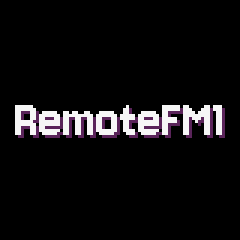

# Bluetooth audio: the sound on the FM-1, no screen (0.3.6)

Over USB the FM-1 is a sound card, so a host's sound already plays on it. Over Bluetooth MIDI there was no sound: the
link carries the screen and nothing else. The audio mode trades one for the other. The host sends its sound as
compressed blocks and stops sending the screen. The FM-1 plays the sound and shows its own "RemoteFM1" screen, in the
standalone's pixel font and theme, and nothing else. LEDs, keys, knobs, MASTER and the TRS
MIDI in work as in any session.

It is **off by default**, on every host. The protocol is in docs/PROTOCOL.md section 9.

## Bandwidth

The fast radio (fm1-base patches 0002/0003: data length 251, 2M PHY, MTU 247, 7.5 ms asked first) was measured
with a Mac on 2026-10-27: 35-38 KB/s of 1 KB SysEx frames host to device, nothing lost with 14 KB in flight
(fm1.toml; libremotefm1 paces TILES at 30 KB/s). That is the link this mode is sized for.

| Stream | Body | On the wire (SysEx, 7-in-8) | Share of 35 KB/s |
|---|---|---|---|
| 22,050 Hz mono IMA ADPCM (the default, `div` 2) | 11.4 KB/s | **13.7 KB/s** (measured in the test) | 39 % |
| 14,700 Hz (`div` 3) | 7.6 KB/s | 9.1 KB/s | 26 % |
| 11,025 Hz (`div` 4) | 5.7 KB/s | 6.9 KB/s | 20 % |
| for comparison: 16-bit 22,050 Hz PCM | 44 KB/s | 50 KB/s | does not fit |

A block is 256 samples (11.6 ms at 22,050 Hz): 5 header bytes and 128 data bytes, 158 bytes as SysEx, one BLE packet
at MTU 247. BLE-MIDI's own headers add about 2 %. The rest of a session is small next to it: LEDS (59 bytes a change,
about 1 KB/s while they animate), PANEL_R, AUDIO_R and the panel's events (device to host). So the default leaves
about 2.5x headroom on a Mac-class link, and it fits the stock radio (6 KB/s) only at 11,025 Hz, barely, so a host
should keep the default and fall back to the screen if the unit reports underruns.

Not measured here: Windows' and Android's Bluetooth MIDI stacks, which are slower than macOS's for SysEx (Windows
especially). The unit reports `underruns` and `lost` in AUDIO_R, so a host can see a link that does not keep up.

## Quality to expect

- **Mono, 22,050 Hz, band-limited to ~9.9 kHz** (the host's 64-tap Kaiser low-pass at 0.45 x the rate): no "air",
  cymbals and bright FM bells lose their top octave.
- **IMA ADPCM, 4 bits a sample: about 30 dB SNR** (30.8 dB measured on a -6 dBFS sine through the whole chain,
  resampler, coder, the unit's decoder and its 2x Hermite upsampling). Audible as hiss and grit on quiet passages and
  sustained pure tones, much less so on dense material. Roughly early-'90s sampler or game audio. Good for playing
  and monitoring, not for judging a mix.
- **Latency: about 150-200 ms from a key to its sound.** The key press goes to the host over Bluetooth (~10-30 ms),
  the host renders and taps its sound in 1024-frame chunks (~21 ms), the unit holds 120 ms before it plays (the
  `buffer_ms` default; 40..250 ms). That is noticeable when playing fast; a host may ask for a smaller buffer on a
  steady link (each underrun is a short fade out and in).
- **Clock drift is followed:** the unit plays up to ±0.3 % (5 cents) faster or slower to keep its buffer at the
  target, so a host clock that runs a little fast or slow never drifts the latency. A host that stalls (a busy
  browser tab) gives an underrun: the sound fades out and comes back once 120 ms are buffered; a burst after it is
  trimmed by dropping a block.

## What it costs the firmware

- Code: +2.2 KB (Bluetooth package 337,072 -> 339,280 B).
- RAM: none of the 98 KB .data+.bss; 112 B of the pool (the player's state). The 4.3 KB ring of coded blocks (32 x
  134 B, ~370 ms) is the screen shadow's last rows: the mode draws no TILES, and its end clears the shadow to black.
  (The pool's 8 KB headroom check failed with the ring as a pool buffer of its own.)
- CPU: decoding and interpolating in the audio interrupt, ~10 operations a sample at 44.1 kHz: negligible next to the
  render.

## How it is negotiated

1. A session over Bluetooth starts as always (SESSION start, ACK).
2. A host with the option on, whose unit's HELLO_R has `caps` bit11, sends AUDIO_MODE on (22,050 Hz, 120 ms).
3. The unit answers AUDIO_R on, switches to its own screen, and plays what AUDIO brings. libremotefm1 starts sending
   sound only on that AUDIO_R, and from then on sends no TILES.
4. AUDIO_MODE off, a session restart, the session's end, or the Bluetooth link gone end the mode. If the session
   goes on, the unit's screen and shadow are black, its next FRAME_ACK says "shadow reset", and the host sends the
   whole screen again. An unanswered AUDIO_MODE is retried after 1 s, at most 4 times a session, then the session
   stays on the screen.

USB links never use it (libremotefm1 asks only on a Bluetooth frame link).

## The web player (remotefm1.com)

- Settings > USE MY FM-1 > **Sound on the FM-1 over Bluetooth**, off by default (prefs `fm1BleAudio`).
- With it on and the FM-1 connected over Bluetooth, the AudioWorklet's tap posts the engine's sound (before the
  page's volume, mono) in 1024-frame chunks; remote.js passes them to libremotefm1 (`audio(pcm, rate)`), and the page
  mutes its own output while the unit plays it (`status.audio`). The connection line says "sound on the FM-1, no
  screen".
- remote.js: option `bleAudio`, `setBleAudio(on)`, `audio(pcm, rate)`, `status.audio`, `unit.bleAudio`, and the
  `audio*` stats (web/remote/README.md).

Trying it from a checkout: `web/serve.sh [--build] [PORT]` serves `web/` on 127.0.0.1 after checking the engines are
built (`web/site/tools/engines-check.mjs`). A checkout has the page but not its engines (build outputs), and a page
without them plays the mock engine's "TEST SCREEN" on every firmware, on the page and on a connected FM-1: that is
what a fresh worktree served with `python3 -m http.server` showed on 2026-11-08, with or without the audio mode.

## Tests

- `host/tests/test_ble_audio.c` (host/run_tests.sh, ctest `ble_audio`): libremotefm1's session against the
  firmware's own rfm_app.c and rfm_audio.h over a simulated 35 KB/s Bluetooth link, the host's clock 100 ppm fast: the
  mode comes on, no TILES while on, 13.7 KB/s, no loss or underrun once settled, the buffer near 120 ms, the sine at
  30.8 dB SNR; a 300 ms host stall fades and recovers; off, the screen comes back exactly.
- `firmware/tests/ble_audio.txt` (tests/run_tests.sh): the app in the simulator over Bluetooth: AUDIO_MODE, the
  screen shots (`rf_audio_screen.png`, `rf_audio_playing.png`, `rf_audio_black.png`), blocks played and a seq gap
  counted, TILES not shown, USB's request refused, off black, the link's end.
- web/remote/test/test_remote.mjs "Bluetooth audio": remote.js with the WASM session against the fake unit.

**Not yet tried on a unit.** Needs a flash of this branch on an FM-1 and a Mac connected over Bluetooth MIDI.

## What the other hosts need to follow

All three use libremotefm1, which has the whole host side (`rfm_session_set_ble_audio`, `rfm_session_audio`,
`rfm_session_audio_on`, the resampler and coder in `host/src/audio.c`).

**Every host, when it bumps the RemoteFM1 submodule:** add `host/src/audio.c` to its libremotefm1 sources (session.c
and fake.c call it; it also needs libm), or the link fails.

- **FM1VST (JUCE, macOS):** nothing to add for the build (its CMake globs `host/src/*.c`; `firmware/src` is already on
  the include path for remote_proto.h). To use it: a plugin option "Sound on the FM-1 over Bluetooth" (off) ->
  `cfg.ble_audio` / `rfm_session_set_ble_audio`; in `processBlock`, the core's output summed to mono goes to a
  lock-free FIFO, and the thread that polls the session (RemoteLink) passes it to `rfm_session_audio(s, pcm, n,
  sampleRate)` (libremotefm1 is single-threaded: never call it from the audio thread); mute or keep the DAW's output
  as the user chooses (a plugin's output usually should keep going). Show `stats.audio` / `audio_underruns`.
- **RemoteFM1IOS (Swift, RFMKit):** add `\(rfm)/host/src/audio.c` to `RFMKit/Package.swift`'s sources. A setting
  (off) in the FM-1 connection sheet; an `AVAudioEngine` tap (or the AUv3 host's render callback into a ring) summed
  to mono, handed to `rfm_session_audio` from the session's queue with the engine's sample rate; mute the device's
  own output while `rfm_session_audio_on`. iOS's Bluetooth MIDI goes through CoreMIDI as on the Mac, so the Mac's
  numbers should hold; check on a device.
- **RemoteFM1Android (Kotlin, Oboe, native/CMakeLists.txt):** add `${RFM}/host/src/audio.c` to the native sources
  (and `m`). An Oboe callback copies mono frames into a ring; the session thread drains it into `rfm_session_audio`.
  Android's BLE MIDI (android.media.midi over BluetoothGatt) negotiates its own connection interval and MTU and may
  be far slower for SysEx than macOS: measure the throughput first (FM1 STATS_R's radio readout shows what the link
  negotiated) and keep the screen if the unit reports underruns; 14,700 or 11,025 Hz (`cfg.audio_div` 3 or 4) may be
  the right default there.

## Ideas not done

- Pick `div` by the link: start at 22,050 Hz and step down when AUDIO_R reports underruns (the unit takes a new
  AUDIO_MODE at any time).
- Stereo as mid/side with a narrow side, or noise shaping in the coder: neither fits the budget at 22,050 Hz.
- A firmware setting to refuse the mode: hosts already keep it off unless asked, so the unit needs none today.
- The M-Vave SMK-37 build answers the same caps (it is an FM-1 to every host); whether it has a speaker or line out
  for the sound is not checked.
